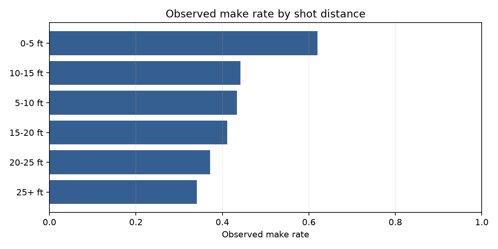
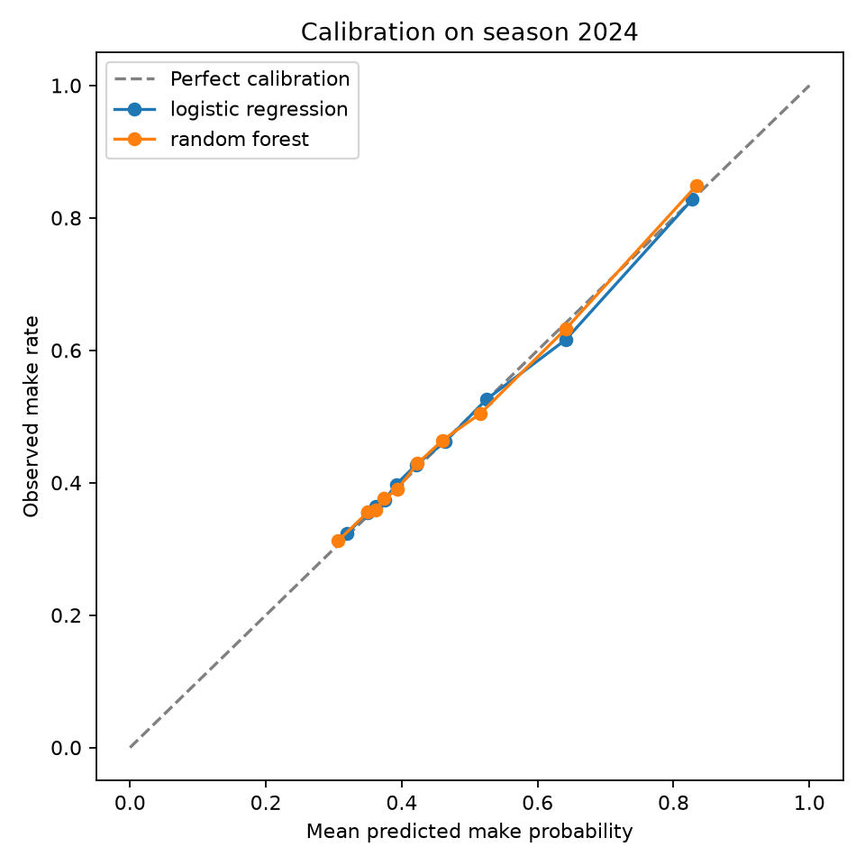

# NBA Shot Outcome Modeling

An independent portfolio analysis of NBA shot outcomes using publicly available shot chart records. This is a separate public-data project; no internship assessment data, code, prompts, original writeup, or original results are included here.

## What I found

The analysis covers 872,168 regular-season shots across four source season labels (2021–2024). The overall make rate was 46.95%. Distance showed the clearest pattern: 61.97% of attempts from 0–5 feet were made, compared with 34.13% from 25 feet or more. Two-point shots had a 54.27% make rate and three-point shots 36.00%.

I held out full seasons to check how well the probability models transferred forward. On the 2024 holdout, the random forest had log loss 0.6366 and Brier score 0.2239, compared with 0.6910 and 0.2489 for a constant-rate baseline. The logistic regression scores were 0.6419 and 0.2262. Lower is better for both metrics. This is retrospective shot-quality analysis based on recorded shot context, not a pre-shot decision model.

| Holdout season | Model | Log loss | Brier score |
|---|---|---:|---:|
| 2023 | Constant-rate baseline | 0.6919 | 0.2494 |
| 2023 | Logistic regression | 0.6428 | 0.2267 |
| 2023 | Random forest | 0.6370 | 0.2242 |
| 2024 | Constant-rate baseline | 0.6910 | 0.2489 |
| 2024 | Logistic regression | 0.6419 | 0.2262 |
| 2024 | Random forest | 0.6366 | 0.2239 |

## Project report

The report includes the analysis, model comparison, calibration and feature importance discussion, and limitations.

[Open the project report](public_shot_model_report.docx)

## Figures and results

The figures and JSON summaries in `results/` contain the published aggregate outputs.





Other figures: [shot type](figures/make_rate_by_shot_type.png), [court zone](figures/make_rate_by_zone.png), [recorded action](figures/make_rate_by_action.png), [feature importance](figures/feature_importance.png), and [2023 calibration](figures/calibration_2023.png).

## Data and limitations

The scripts accept season-specific CSVs for the `shotdetail` data described by [shufinskiy/nba_data](https://github.com/shufinskiy/nba_data), whose repository describes the shot details as sourced from NBA Stats. That repository lists an Apache-2.0 license, but it does not establish a license from the NBA for the underlying records. Review the source and applicable terms before use. No dataset is redistributed in this project.

The model uses shot distance, court location, shot type, action type, period, clock, and shot-zone fields. It does not include defender tracking or contest distance. Results are observational, can reflect season composition and recording differences, and do not show that any feature causes a make. Feature importance is a model diagnostic, not a causal ranking.

## Reproduce

1. Download and extract two or more regular-season `shotdetail_YYYY` CSV files into `data/raw/`, retaining the year in each filename (for example, `shotdetail_2022.csv`).
2. Install dependencies and run the analysis:

```bash
python -m pip install -r requirements.txt
python scripts/prepare_data.py
python scripts/evaluate.py --validation-season 2023
python scripts/evaluate.py --validation-season 2024
python scripts/build_report.py
```

The scripts write source-derived intermediate files to ignored `data/` and `reports/` folders. Generated report metrics and figures are not the internship results.

## Project structure

```text
scripts/       # data preparation, evaluation, and report generation
figures/       # published aggregate charts
results/       # published aggregate metric summaries
```
